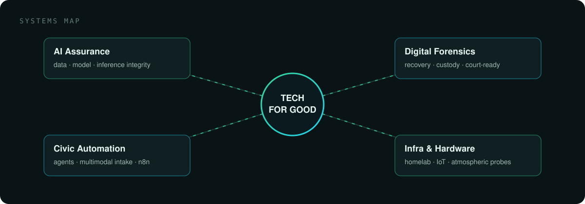

  

<h1 align="center">Aditya Tipirneni</h1>

  <b>AI • Automation • Security • Systems</b> 
  2× Hackathon Winner · Founder @ TeenTechIndia · B.Tech CSE @ KMIT

  
  
  

  <b>I build technology for good.</b> 
  From AI assurance and digital forensics to agentic civic platforms and self-hosted infrastructure.

  

  

<table align="center">
  <tr>
    <td align="center" width="25%"><h3>Yatharth</h3><b>Published</b> PyPI · npm</td>
    <td align="center" width="25%"><h3>AI Automation</h3><b>Intern</b> Multiple firms</td>
    <td align="center" width="25%"><h3>TeenTechIndia</h3><b>Founder</b> Tech-for-good umbrella</td>
    <td align="center" width="25%"><h3>Mentor</h3><b>Hackathon teams</b> Many winning builds</td>
  </tr>
</table>

## 01 / Current signal

### 🖥️ Personalised home-server infrastructure

Turning an M2 Mac mini into a self-hosted platform: isolated Docker sandboxes (Python, Node, Java, C++, Go, databases, web/API, Kali), a web IDE, file manager and a central portal behind single sign-on with Authentik. Private admin over Tailscale SSH; public sites through Cloudflare Tunnel on my own domain.

`Docker` `Tailscale` `Cloudflare Tunnel` `Authentik` `macOS` `Linux`

## 02 / Selected systems

### 🛡️ Yatharth
**AI supply-chain assurance for defence computer vision · Team SPARCX**

Offline, air-gapped assurance for object-detection datasets and the models trained on them — catches poisoned or flipped labels, duplicates and leakage, backdoor triggers, substituted models, doctored pipelines and tampered prediction logs. Every finding carries its measurements and its limits; nothing is called an attack until independent checks agree.

20 checks · 150/150 planted backdoor images recalled · 0/10 decoys flagged · 5/5 booby-trapped model files refused · full dataset + YOLOv8 run in 290 s on a laptop GPU.

`Python` `PyTorch` `DINOv2` `ONNX` `Ed25519` `Merkle log` · Published on `PyPI` and `npm`

[**View repository ↗**](https://github.com/theusscoder/yatharth) · [**Recorded runs ↗**](https://yatharth.teentechindia.com)

### 🔍 Sarvadristhi
**Multi-vendor DVR/NVR forensic analysis**

Takes a recorder disk, image or export, identifies the on-disk format from its bytes, and recovers every frame it can — even from formatted or partly overwritten disks. Attributes each frame to a camera and time, detects clock drift and changes, and produces a hashed, custody-logged court report with a signed replay capsule anyone can re-verify.

100% frame recovery across Hikvision and Dahua scenarios (intact, formatted, overwritten) on test evidence with frame-level ground truth.

`Python` `FFmpeg` `H.264/H.265` `OpenCV` `Tesseract` `Ed25519`

[**View repository ↗**](https://github.com/theusscoder/sarvadristhi)

### 🏙️ Urban Pulse
**AI4Impact 2026 · Agentic governance & grievance resolution**

An AI agent swarm that resolves public grievances instead of just logging them: omnichannel intake (WhatsApp, web, Hindi voice, handwritten letters), root-cause clustering, impact-based prioritisation, spatial dispatch to the nearest qualified officer, and photo-verified resolution with live heatmaps.

`FastAPI` `LangGraph` `PostgreSQL + PostGIS` `Pinecone` `n8n` `Next.js` `Expo`

[**View repository ↗**](https://github.com/aditya36900/urban-pulse)

[**Explore all repositories →**](https://github.com/aditya36900?tab=repositories)

## 03 / Working set

  

| | |
|---|---|
| **AI & Assurance** | PyTorch · TensorFlow · DINOv2 · ONNX · OpenCV · LangGraph · LangChain · RAG · agentic systems |
| **Automation & Backend** | n8n · FastAPI · Flask · PostgreSQL · Pinecone · REST APIs · webhooks |
| **Security & Forensics** | penetration testing · digital forensics · custody & provenance · Ed25519 · Merkle logs |
| **Infra & Hardware** | Docker · Linux · homelab · Tailscale · Cloudflare · Raspberry Pi · IoT · telemetry |

## 04 / Along the clock

  

## 05 / Credentials & range

**Recognition**

• 2× hackathon winner. • Amazon HackOn and Microsoft Imagine Cup — participant. • Mentor to multiple hackathon-winning teams.

**Earlier builds**

• Sentinel.AI — autonomous multi-agent penetration-testing platform. • K-SAT-AANBHS-01 — low-cost atmospheric sounding probe with real-time telemetry. • Derma AI — dermatological screening model, built in a 24-hour national hackathon. • Smart Helmet — Raspberry Pi rider-safety system.

**Beyond code**

• Founder, TeenTechIndia. • Freelance web, app and game developer.

  <a href="mailto:aditya@teentechindia.com">Email</a> · <a href="https://www.linkedin.com/in/sai-aditya-tipirneni/">LinkedIn</a> · <a href="https://github.com/aditya36900?tab=repositories">Repositories</a>

TECH FOR GOOD · ADITYA36900

